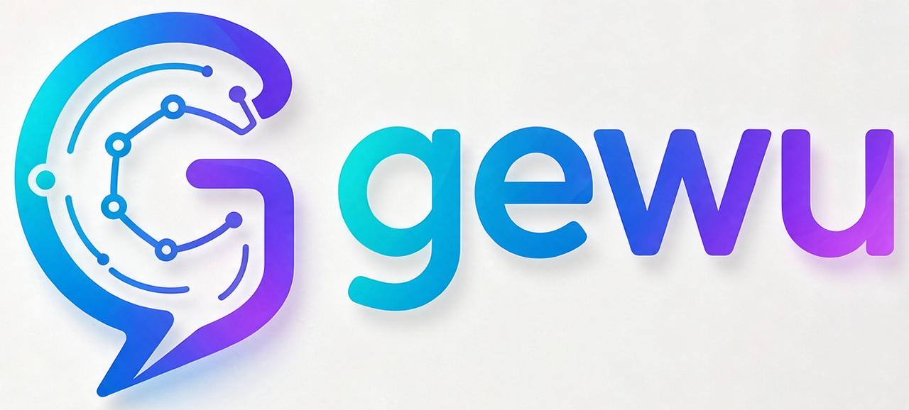

# Gewu — Enterprise-Grade AI Agent Platform

<p align="center"></p>

<p align="center">
  <a href="#-quick-start"></a>
  <a href="#-quick-start"></a>
  
  
  
  
</p>

**Gewu** is a full-stack, enterprise-grade AI Agent platform built on **LangChain4j 1.11.7 + Spring Boot 3.2 + PostgreSQL/pgvector**. It covers six capability domains — streaming chat (true SSE), RAG knowledge base, versioned prompt management, LLM monitoring & usage reporting, agent tool orchestration (human-in-the-loop approval gateway), and a dynamic model configuration center — ready to use as an enterprise AI middle-platform foundation or a starting point for customization.

> Backend ~15.7k lines of Java (156 source files + 8 test classes, 4 Maven modules) | [Frontend](https://github.com/gewu-platform/gewu-web) ~11.1k lines of Vue | 16 PG tables | 93 REST endpoints

[中文](README.md) · [API Reference](docs/API.md) · [Tool Extension](docs/EXTEND-TOOL.md) · [Architecture](docs/ARCHITECTURE.md) · [Deployment](docs/DEPLOY.md)

---

## ✨ Capabilities

| Domain | Description |
|------|------|
| 💬 **Chat** | 27 endpoints: session CRUD, true token-by-token SSE streaming, multimodal attachments (V2.5.0 M1), token usage persisted |
| 🤖 **Agent Orchestration** | Native lc4j function-calling loop, 5 chat entries, **suspendable approval gateway** (human-in-the-loop, resumes on the same SSE connection), agent definition CRUD + 3 preset templates |
| 📚 **RAG Knowledge Base** | md/txt/pdf/docx upload → async chunked indexing (2048-dim) → pgvector cosine search → per-agent knowledge binding (request-level overrides) |
| 🧩 **Prompt Management** | Versioned templates (auto +1 on create), variable extraction, rendered execution, one-click rollback |
| 📊 **Monitoring & Reporting** | `llm_call_log` end-to-end tracing, today's stats card, 24h distribution, model leaderboard; **usage reports in 3 views** (day/user/agent) + per-user daily token quota |
| ⚙️ **Model Configuration Center** | Dynamic chat/embedding providers (AES-256-GCM encrypted keys), save-and-apply instantly, connectivity test, write-only secrets |

## 🏗️ Architecture

```
gewu/                                gewu-web/
├── gewu-common/   unified response/exception/crypto   ├── src/views/   pages (Vue3 + AntD)
├── gewu-client/   LLM dynamic factory        ├── src/api/     modular API clients
├── gewu-web/      business modules           └── nginx serves dist + /api reverse proxy
│   ├── auth/user       auth & users
│   ├── chat            sessions/SSE/multimodal
│   ├── agent           orchestration/tools/approval
│   ├── knowledge       RAG
│   ├── monitor         monitoring/reports/quota
│   ├── audit           audit log (admin-plane trail)
│   ├── settings        model configuration center
│   ├── mcp             MCP client & bridging
│   ├── plugin          plugin registry
│   └── prompt          template management
└── database/gewu-init.sql  idempotent schema (16 tables)
```

Details in [docs/ARCHITECTURE.md](docs/ARCHITECTURE.md).

## 🚀 Quick Start

```bash
# 0. Get the code (two repositories)
git clone https://github.com/gewu-platform/gewu.git
git clone https://github.com/gewu-platform/gewu-web.git
```

**Prerequisites**: JDK 17, Node 18+, PostgreSQL 16 (with the pgvector extension), and one OpenAI-compatible model endpoint (Volcano Ark / DeepSeek / Qwen, etc.).

```bash
# 1. Create the schema (idempotent script, all 16 tables + seed data)
psql -U postgres -d gewu -f database/gewu-init.sql

# 2. Configure models (via environment variables, no code changes)
export VOLC_API_KEY=sk-xxx          # or any other OpenAI-compatible endpoint key
export GEWU_ENCRYPT_KEY=$(openssl rand -base64 48)   # required in production: model key encryption

# 3. Start the backend (8081)
mvn spring-boot:run -pl gewu-web

# 4. Start the frontend (3001, proxies to 8081)
cd ../gewu-web && npm i && npm run dev   # frontend repo: github.com/gewu-platform/gewu-web
```

Open `http://localhost:3001` in your browser; the default admin account is documented in the `.env.example` comments. For Docker deployment (one-command server+db via compose), see [docs/DEPLOY.md](docs/DEPLOY.md).

## 🔌 API Overview

93 REST endpoints; the full contract is in [docs/API.md](docs/API.md):

| Module | Representative endpoints |
|---|---|
| Chat | `POST /api/chat/message/stream` (SSE), `GET /api/chat/models` |
| Agent | `POST /api/agent/chat/stream` (10-event contract), `/api/agent/definitions` CRUD |
| Knowledge | `POST /api/knowledge/upload`, `GET /api/knowledge/search` |
| Monitoring | `GET /api/monitor/stats`, `GET /api/monitor/usage/report?view=day|user|agent` |
| Model config | `POST /api/settings/providers`, `POST /api/settings/providers/{id}/test` |

## 💡 Technical Highlights

1. **True streaming SSE on the Servlet stack** — SseEmitter pushes events one by one from a background thread (measured 161 events spread over 103ms); the classic pitfall of Flux being buffered by MVC is already handled
2. **Suspendable tool approval (human-in-the-loop)** — while waiting for approval the same SSE connection stays alive with heartbeat pings; once approved the loop resumes in place, no re-orchestration needed
3. **Native lc4j function-calling orchestration** — ToolRegistry reflective registration (@Component + @Tool plug-and-play), definition-level tool binding, three-state approval
4. **RAG retrieval pipeline** — multi-format parsing (POI/PDFBox) + 2048-dim multimodal embedding + cosine search + configurable threshold
5. **Model configuration center** — DB-first with yml fallback dual-source factory; secrets encrypted at rest; changes apply instantly with zero restart

## 🛡️ Security Baseline

- JWT + DB-backed token state validation (invalidated on logout)
- Write-only secrets: the API only ever returns `sk-****` masks; if `GEWU_ENCRYPT_KEY` is unset a dev key is used as fallback (**must be configured in production**)
- User identity is resolved server-side; the `userId` in request bodies is untrusted; quota exhaustion returns 429

See [SECURITY.md](SECURITY.md) for details.

## 📊 Data Flow & Privacy

**In one sentence**: state, memory and credentials all live on your own machine; Gewu itself sends nothing anywhere else.

| Data category | Stored at | Leaves the machine? |
|---|---|---|
| Chat messages / session metadata | Local PostgreSQL (`chat_message` / `chat_session`) | No |
| Knowledge documents & vectors | Local PostgreSQL + pgvector (`document_chunk.embedding`) | No |
| Model credentials (API keys) | Local DB (returned as `sk-****` masks, never in plaintext logs) | No |
| Agent definitions / prompts / Skill references | Local PostgreSQL | No |
| Audit logs | Local PostgreSQL (`audit_log`, key fields masked) | No |
| LLM call monitoring | Local PostgreSQL (`llm_call_log`) | No |
| Uploaded raw files (knowledge base / chat attachments) | MinIO file storage (self-hosted bucket objects; mount its data volume for container deployments) | No |

**The only two things that actually leave the machine**:

1. **Model calls**: your prompts and context are sent to the model provider **you configured** (Volcano Ark / OpenAI-compatible endpoints / local Ollama). This is inherent to any LLM application — without sending content to a model there is no answer. Which provider and which key is entirely your decision in the Model Configuration Center.
2. **External tool calls**: if you enable MCP plugins or web-search tools, requests go to the endpoints **you filled in** in the plugin / MCP configuration. Not configured → nothing happens.

**What Gewu itself never sends**: no telemetry, no usage statistics, no version checks, no crash reports, no "anonymous improvement programs".

> This document evolves with the product. If any statistics or version check is ever introduced, the rule is **off by default and configurable** — and it must be declared here first; it will never be switched on silently.

**How to verify it yourself** (without trusting this statement — read the code / watch the network):

1. **Static scan**: search the repo for `telemetry|analytics|sentry|crash|checkUpdate`; the only match is `selectLatestVersion` in prompt templates (version management, not an outbound check)
2. **Network observation**: with the app running but no conversation started, there are no outbound connections besides the database; when a conversation starts, the only connection is to the endpoint configured in the Model Configuration Center
3. **Frontend assets**: the built frontend bundle contains no third-party CDN / font / tracking scripts; all dependencies are installed locally via `npm i`

---

## 📖 Documentation

| Document | Contents |
|---|---|
| [docs/API.md](docs/API.md) | Full API contract + SSE event table + quota/model configuration notes |
| [docs/EXTEND-TOOL.md](docs/EXTEND-TOOL.md) | Custom tool development (3 steps) |
| [docs/ARCHITECTURE.md](docs/ARCHITECTURE.md) | Architecture map + data flow + extension points |
| [docs/DEPLOY.md](docs/DEPLOY.md) | Docker / nginx deployment + offline package + FAQ |
| [docker/README.md](docker/README.md) | Build entry index (two modes / root-directory constraints) |
| [docs/plan/](docs/plan/ROADMAP.md) | Release planning (ROADMAP + per-version PLANs) |

> The documentation suite is currently written in Chinese; API tables are largely language-neutral. An English documentation suite is on the roadmap.

## License

[Apache-2.0](LICENSE)
